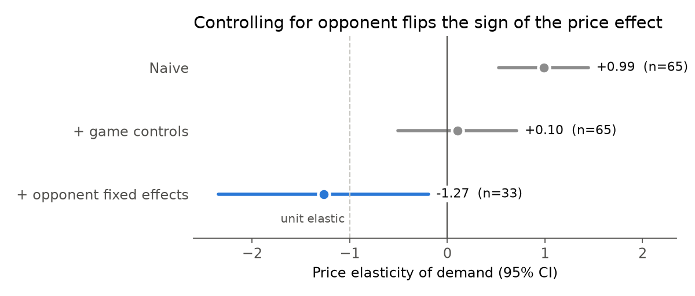
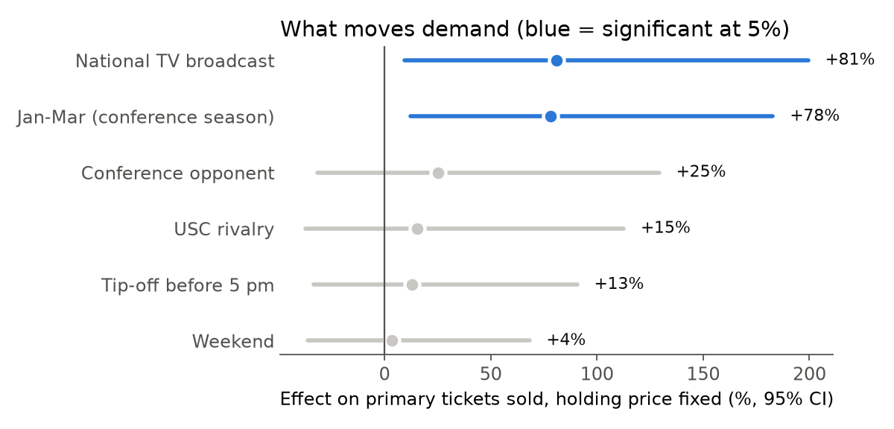
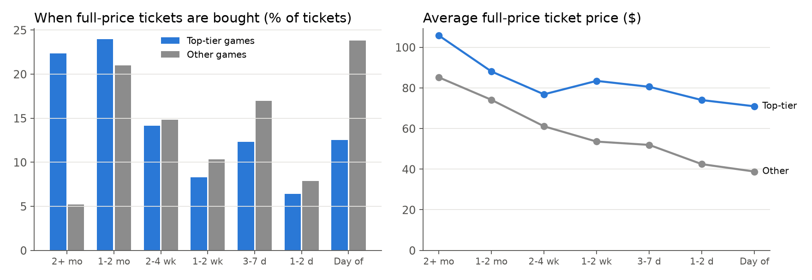

# Game Demand & Price Elasticity — UCLA Men's Basketball

**If UCLA raises single-game ticket prices, does it make more money?** This project estimates the price elasticity of demand for UCLA Men's Basketball home games across five seasons (2021-22 to 2025-26). It also quantifies what else drives ticket sales and looks at *when* buyers purchase.

It's a small-sample causal-inference problem: 65 home games, where price is set by the same thing that drives demand, opponent quality. The main lesson is how wrong the naive answer is.

> **Data note:** the ticketing data belongs to UCLA Athletics and is **not included**. A synthetic data generator with the same schema (and a *known* true elasticity) lets the full pipeline run (see [Reproduce](#reproduce)). Results below come from the real data.

---

## Key findings

**1. The naive regression says higher prices *increase* sales. That's confounding.** Games against USC, Arizona or Purdue are priced highest *and* sell the most, because opponent quality drives both price and demand. Comparing the **same opponent across seasons** (opponent fixed effects) removes that, and the sign flips.



| Model | Elasticity | 95% CI | Games |
|---|---|---|---|
| Naive: log(tickets) ~ log(price) | **+0.99** | +0.53 to +1.45 | 65 |
| + game controls (TV, conference, weekend, tip time, season) | +0.10 | −0.51 to +0.71 | 65 |
| **+ opponent fixed effects** | **−1.27** | −2.34 to −0.19 | 33 |

**2. Demand is roughly unit-elastic, so uniform price increases don't raise revenue.** With elasticity ≈ −1.27, a 10% price increase changes primary single-game revenue by about **−2.5%** (95% CI: −12% to +8%). There's no evidence that across-the-board price hikes pay off. Revenue upside has to come from *targeting* (which games, which windows), not the overall price level.

**3. Broadcast and calendar matter more than day of week.** Holding price fixed:



- **National TV games** sell about **81%** more primary tickets (95% CI +9% to +199%).
- **Conference-season games (Jan–Mar)** sell about **78%** more (+12% to +183%).
- Weekend, early tip-off, conference opponent and the USC rivalry are all positive, but none is significant with 65 games.

**4. Top-tier games sell early; everything else sells late.**



- For **top-tier games**, 46% of full-price tickets are bought **more than a month ahead**, at $88–106 per ticket.
- For **other games**, the single biggest window is **game day** (24% of tickets), at an average of $39, less than half the early price.
- *Caveat:* average price per window mixes dynamic price changes with seat-location mix, since early buyers also pick better seats.

## What I'd recommend

1. **Don't raise prices uniformly.** At unit elasticity the revenue gain is about zero and the attendance loss is real.
2. **Price top-tier games earlier.** Demand for them is front-loaded, so on-sale timing and early-window pricing are the levers, not day-of discounts.
3. **Use day-of pricing for low-tier games.** A quarter of their buyers decide on game day, and those buyers respond to price.
4. **Use national TV slots and conference-season dates as demand signals** when setting tiers. They predict demand independently of opponent.

## Method

**Unit:** one row per home game.

**Demand:** *primary paid* tickets, meaning tickets UCLA sold directly at a price above $0 (full price, promo, group). Resale, transfers, pass claims and season-seat inventory are excluded because UCLA doesn't set those prices game by game.

**Price:** average paid price of those tickets.

**Data quality:**
- 2025-26 games after the data export date (Jan 26, 2026) are dropped because their sales are incomplete.
- One game with obviously missing data is dropped.
- Exhibitions are excluded.

**Identification:**
- *Opponent quality* is the confounder.
- The "price tier" is built *from* price, so it's used only for description, never as a control.
- Controls use non-price proxies: conference opponent, USC rivalry, national TV.
- The fixed-effects model uses the 33 games against opponents UCLA hosted more than once (USC 4×; Oregon, Washington, Stanford, Cal, Colorado 3×; …), so the elasticity comes from *price changes for the same matchup across seasons*. Robust (HC1) standard errors.

**Validation on synthetic data:** the generator builds in the same confounding with a true elasticity of **−1.2**. The pipeline gets a naive estimate of +1.3 (wrong sign), and the fixed-effects confidence interval (−1.49 to −0.15) covers the true value.

## What didn't work: forecasting game demand

I also tried forecasting each game's ticket sales *before* pricing it, using leave-one-season-out cross-validation with features like TV, conference, calendar and the opponent's last visit:

| Model | MAE (tickets) | Median abs. % error |
|---|---|---|
| Season-average baseline | 731 | 49% |
| Ridge regression | 726 | 53% |
| Gradient boosting | 789 | 55% |

With about 65 games and no data on team strength (rankings, records), the models barely beat the baseline. I didn't use them to flag "mispriced" games, since that would put weight on noise. Adding opponent ranking and UCLA's record at game time is the obvious next step.

## Limitations

- **Small sample:** the fixed-effects estimate relies on 33 games, so the confidence interval is wide.
- **Average price per game** blends seat sections; seat-level inventory and capacity data would allow section-level elasticities.
- **Sell-outs** would cap observed demand (censoring). Primary single-game sales here are well below Pauley capacity, but section-level sell-outs can't be seen.
- **Missing signals:** no team-performance or opponent-ranking data.

## Repo structure

```
├── src/
│   ├── build_games.py     # ticket lines + schedule -> one row per home game
│   ├── analysis.py        # elasticity (3 models), drivers, forecast CV, revenue sensitivity, pricing windows
│   └── make_synthetic.py  # fake data with known elasticity
├── reports/               # figures, elasticity_estimates.csv, demand_drivers.csv, summary.json ...
├── data/                  # git-ignored except synthetic/
└── requirements.txt
```

## Reproduce

```bash
conda create -n mbb-pricing python=3.11 -y && conda activate mbb-pricing
pip install -r requirements.txt

# Synthetic data (anyone)
python src/make_synthetic.py --out data/synthetic
python src/build_games.py --raw data/synthetic --out data/processed/games_synthetic.csv
python src/analysis.py --games data/processed/games_synthetic.csv --raw data/synthetic \
    --figs reports/figures_synthetic --out reports/synthetic

# Real files in data/raw/ (mbb_joined_data.csv, "mbb schedule.xlsx")
python src/build_games.py && python src/analysis.py
```

Related projects: [season-ticket churn](https://github.com/JefferyChen711/ucla-mbb) · [single-game buyer segmentation](https://github.com/JefferyChen711/ucla-mbb-buyer-segments)

---
*Tools: Python, pandas, statsmodels (OLS with fixed effects, robust SEs), scikit-learn, matplotlib*
